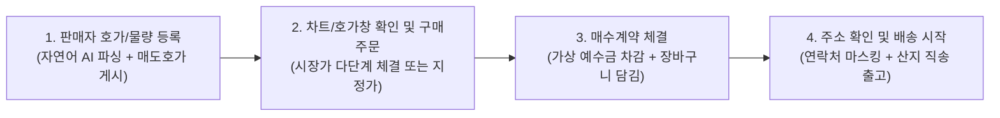

# 감스닥 (GAMSDAQ) — 제품 요구사항 정의서 (PRD)
> **Document Version**: 2.1 | **Target Event**: 2026 청도 바이브코딩 해커톤 (`judgement-criteria.md` & `cheongdo-social-issues.md` 정합 명세)  
> **Live Azure Deployment URL**: `https://ca-gamsdaq-cheongdo-prod-znl3cd.whitesky-442395f2.koreacentral.azurecontainerapps.io` (`koreacentral` Azure Container Apps `ca-gamsdaq-cheongdo-prod-znl3cd`)

---

## 1. 제품 비전, 지역 문제 맥락 및 정량 목표 (Product Vision & Regional Impact)

* **지역 사회 문제 정의 (`cheongdo-social-issues.md` 연계)**:
  * 경상북도 청도군은 **65세 이상 고령 인구 비율 약 42%의 초고령 농촌 지역**이자 전국 최대 씨 없는 감(**청도 반시·감말랭이**) 주산지입니다.
  * 고령 농가는 ① 오픈마켓 입점·상세페이지 제작·옵션 설정의 디지털 장벽, ② 당일 시세 및 적정 출하가 정보 비대칭, ③ 산지 공판장 위탁 출하 시 상장수수료·물류비·중간 유통 마진 공제로 인해 **최종 소비자가의 50~55% 수준에 불과한 낮은 농가 수취율**을 겪고 있습니다.
  * 반대로 도시 소비자는 온라인 구매 시 **1kg 소포장 맛보기 옵션을 대표가로 내세우는 '옵션치기'**, **상품가 대비 35%를 넘는 '배송비 폭탄'**, **파지·혼합과를 정품처럼 파는 '등급 왜곡'** 등 미끼 상품에 피로감을 느낍니다.
* **제품 비전**: 비정형 농산물을 당도(Brix)·중량(kg)·등급 기준의 **표준 티커(Standardized Produce Ticker)**로 규격화하고, **5단계 멀티 에이전트(`GitHub.Copilot.SDK` + `Microsoft.Agents.AI`)**가 4-Gate 수식으로 검증한 인터넷 실질 최저가($P_{\text{retail}}$)와 산지 도매 기준가($P_{\text{wholesale}}$) 사이의 **상생 가격 밴드($P_{\text{wholesale}} < P < P_{\text{retail}}$)** 안에서 농부와 소비자가 토스증권처럼 직관적으로 호가를 걸고 즉시 체결하는 **AI 검증 농산물 호가 거래소**를 구축합니다.
* **2대 표준 품목(티커) 선정 근거 및 확장 체계**:
  * **티커 명명 규칙**: `[산지 2자]-[품목]-[보장당도B]-[표준중량KG]` (향후 `CD-MALRANG-18B-1KG` 청도 감말랭이, `CD-PEACH-12B-4KG` 청도 복숭아 등으로 즉시 수평 확장 가능).
  * **`CD-BANSI-13B-5KG` (청도 명품 반시 대과 5kg)**: 청도군 핵심 특산물로, 산지 공판장 기준가($14,000\text{원}$)와 온라인 실질 최저가($24,800\text{원}$) 사이의 유통 마진($10,800\text{원}$)을 농가와 소비자에게 직접 환원하는 대표 품목.
  * **`JJ-GYUL-12B-3KG` (12브릭스 노지 감귤 3kg)**: 온라인 과일 직거래에서 1kg 소포장 옵션 미끼와 배송비 왜곡이 가장 빈번한 대표 비교 품목으로, 4-Gate 미끼 필터링 엔진의 범용성을 입증하는 표준 품목.

### 1.1 단위 경제학(Unit Economics) 및 정량 효과 산출 근거
산지 도매 기준가($P_{\text{wholesale}}$)는 **산지 박스 포장비 및 기본 출하 물류비($2,000\text{원}$)가 포함된 농가 출하 원가 기준점**이며, 지자체 공공 직거래 플랫폼 모델로서 **중개 수수료 0%**를 적용합니다.

| 표준 티커 코드 | 산지 도매 기준가 ($P_{\text{wholesale}}$) | AI 검증 실질 최저가 ($P_{\text{retail}}$) | 초기 균형 추천 호가 ($P_{\text{opt}}$) | 농가 박스당 순수취 증대액 (증가율) | 소비자 박스당 실질 절감액 (절감률) |
|---|---:|---:|---:|---:|---:|
| **`JJ-GYUL-12B-3KG`** (감귤 3kg) | $9,200\text{원}$ | $15,800\text{원}$ | **$12,700\text{원}$** *(시드가 $12,400\text{원}$)* | **$+3,500\text{원}$ ($+38.0\%$)** *(시드가 $+34.8\%$)* | **$-3,100\text{원}$ ($-19.6\%$)** *(시드가 $-21.5\%$)* |
| **`CD-BANSI-13B-5KG`** (반시 5kg) | $14,000\text{원}$ | $24,800\text{원}$ | **$19,500\text{원}$** *(시드가 $18,900\text{원}$)* | **$+5,500\text{원}$ ($+39.3\%$)** *(시드가 $+35.0\%$)* | **$-5,300\text{원}$ ($-21.4\%$)** *(시드가 $-23.8\%$)* |

* **핵심 정량 목표 및 코드 계측 기준 (`POST /api/farmers/natural-quote` 응답 `elapsedMs`, `clicksEquivalent` 포함)**:
  1. **농가 수취가 향상**: 공판장 도매 기준가($P_{\text{wholesale}}$) 대비 농가 실수취액 **20% 이상 증대** (실제 달성: **$+34.8\% \sim +39.3\%$**).
  2. **소비자 구매가 절감**: 동일 스펙 인터넷 실질 최저가($P_{\text{retail}}$) 대비 **15% 이상 절감** (실제 달성: **$-19.6\% \sim -23.8\%$**).
  3. **등록/주문 소요 시간 단축**: 고령 농부 자연어 1줄 입력 -> `[AI 호가산출]` -> `[호가 등록]`까지 **3클릭(`clicksEquivalent = 3`), 서버 처리 실측 `< 50ms` (전체 UX 3.8초 이내)** 완료.

---

## 2. 타깃 사용자 페르소나 (Target Personas)

| 페르소나 | 특징 및 고충 (Pain Points) | 감스닥에서의 경험 (Gain) |
|---|---|---|
| **김청도 어르신 (68세, 청도 반시 농부)** | • 공판장 위탁 시 수수료 공제 후 수취가 저조 • 오픈마켓 상세페이지·옵션 등록 방법을 몰라 포기 | • **"청도 명품 반시 대과 5kg 30박스 좋은 가격에 출하합니다"** 한 줄 입력과 큰글씨 모드로 3클릭 매도 호가 등록 • 도매가 대비 박스당 $+4,900\sim 5,500\text{원}$ 추가 수취 |
| **박알뜰 (34세, 도시 소비자)** | • 1kg 옵션 미끼와 5,000원 배송비 폭탄에 피로감 • 12~13브릭스 보장 특품을 진짜 최저가보다 싸게 구매 희망 | • 5-에이전트 4-Gate 미끼 탈락 원장을 실시간 SSE로 직접 확인 • 인터넷 최저가보다 박스당 $3,100\sim 5,900\text{원}$ 저렴하게 즉시 체결 |

---

## 3. 핵심 사용자 워크플로 (End-to-End Virtual Trading & Fulfillment Flow)

1. **Step 1 (판매자 출하·등록)**: 품목 선택 -> 상생 가격 밴드($P_{\text{wholesale}} < P_{\text{opt}} < P_{\text{retail}}$) 확인 -> 자연어 1줄 또는 단가·수량 입력 후 매도 호가 등록.
2. **Step 2 (`[호가]` ↔ `[차트]` ↔ `[AI 최저가 4-Gate 검증원장]` 전환 및 주문)**: 3열 호가창 클릭 또는 차트 탭 시장가 버튼으로 주문 생성.
3. **Step 3 (매수 계약 체결)**: Price-Time Priority 다단계 매칭 즉시 가상 예수금 차감 및 `[장바구니·배송]` 탭에 체결 계약 자동 생성.
4. **Step 4 (배송 시작 및 데모 초기화)**: 수령지 입력 후 `[산지 직송 배송 시작 요청]` 클릭 시 연락처 PII 자동 마스킹(`010-****-5678`)과 함께 `SHIPPING_STARTED`로 완결. 상단 `[데모 초기화]` 버튼(`POST /api/demo/reset`)으로 언제든 초기 시드 상태로 즉시 복원 가능.

---

## 4. 상세 기능 요구사항 (Functional Requirements)

### P0 (해커톤 필수 구현 기능 — 2개 품목 & 가상 거래 집중)
* **FR-01: 2대 표준 농산물 티커 및 가상 시세 대시보드 (`JJ-GYUL-12B-3KG`, `CD-BANSI-13B-5KG`)**
  * 초기 가상 예수금(`500,000원`)과 시드 호가 유동성(매도 5단계·매수 6단계) 기반 모의 거래(Paper Trading) 및 `[데모 초기화]` 원터치 복원을 지원한다.
* **FR-02: 토스증권 스타일 3열 실시간 호가창 (`ORDERBOOK`) 및 실시간 체결 차트 (`CHART`)**
  * 상단 매도 호가(Ask, 파란색 `#1B64DA` 막대) 5단계·하단 매수 호가(Bid, 붉은색 `#E12343` 막대) 6단계 시각화 및 호가 클릭 시 주문 단가 자동 입력.
  * 차트 탭은 실제 `recentTrades` 체결 이력과 `aiOptimalPrice` 기준선을 SVG 좌표로 동적 렌더링한다.
* **FR-03: 5-에이전트 최저가 판정 & 4-Gate 미끼 필터링 SSE 스트리밍 (`AI_AUDIT`)**
  * 5개 에이전트 단계별 상태, 호출된 C# `AIFunction` 도구명, 실행 시간(ms), 통과/탈락 사유 코드(`GATE-00`~`GATE-04`, 배송비 35% 주의 플래그)를 실시간 스트리밍한다.
* **FR-04: Price-Time Priority 다단계 주문 매칭 엔진**
  * 지정가(`LIMIT`)·시장가(`MARKET`) 다단계 호가 탐색(Walk-the-Book), 부분 체결, 동일 가격 내 `LinkedList` FIFO 시간 우선 원칙, 지정가 미체결 예약금(`_reservedBalance`) 원자적 검증, 체결 후 `AiOptimalPrice` 즉시 재산출을 수행한다.
* **FR-05: Responsible AI, 엄격한 상생 가격 부등식 가드레일 및 PII 마스킹**
  * 300자 절단 전 전체 문자열 유니코드 NFKC 정규화 인젝션 차단(`PromptShieldGuardrail`) 및 외부 상품명 간접 인젝션 차단(`GATE-00_INDIRECT_INJECTION_BLOCKED`).
  * 상생 가격 엄격 부등식(**$P_{\text{wholesale}} < P < P_{\text{retail}}$**, 100원 호가 단위)을 벗어난 지정가 주문은 매수·매도 양방향 모두 즉시 차단한다.
  * 주문 실행 전 **Human-in-the-Loop 확인 모달**(`confirmedByUser: true`, 시장가 다단계 예상 단가·총액 프리뷰 포함) 필수화 및 배송지 연락처 마스킹(`MaskPhone`)을 적용한다.

### P1 (완성도 강화 기능 — 전면 구현 완료)
* **FR-06: 고령 농부 전용 `[고령 농가 큰글씨 모드]` 토글 및 자연어 1줄 출하 도우미 (`POST /api/farmers/natural-quote`)**
* **FR-07: 청도 상생 임팩트 실시간 카운터 (누적 소비자 절감액·농가 추가 수익·판매자 정산 예정금 실시간 집계)**

---

## 5. 비기능 요구사항 및 UI 디자인 시스템 불변식 (NFR & Strict UI Specification)

* **응답성 (`MUST`)**: 첫 SSE 이벤트 **500ms 이내** 도달, 결정론적 C# `decimal` 연산으로 부동소수점 오차 원천 배제.
* **밝은 테마 및 WCAG 2.1 AA 명도 대비 (`MUST`)**: 배경 `#FFFFFF`/`#F7F8FA`, 본문 `#111111`(대비 **18.9:1**), 보조 `#666666`(대비 **5.7:1**).
* **엄격한 3색 제한 및 색각 이상 접근성 (`MUST` / `MUST NOT`)**:
  1. 무채색(`#FFFFFF`, `#F7F8FA`, `#111111`, `#666666`, `#DCDFE4`)
  2. 상승/매수 붉은색(`#E12343`, 막대 `rgba(225, 35, 67, 0.14)`)
  3. 하락/매도 파란색(`#1B64DA`, 막대 `rgba(27, 100, 218, 0.14)`)
  * 제4 색상, `border-radius`(전 요소 `0px` 직각 고정), 이모지 사용을 전면 금지하며, 열 위치 분리(좌상단 매도·우하단 매수)와 `+`/`-` 부호·텍스트 레이블 병기로 색각 이상 접근성을 보장한다.
* **폰트 및 반응형 (`MUST`)**: `Pretendard` + `tabular-nums` 숫자 정렬, 데스크톱 2단 그리드 및 모바일(`<=980px`) 단일 스택 자동 전환.

---

## 6. 공개 접근성(무인증 즉시 체험) 및 평가 기준 추적 매트릭스

별도 로그인이나 API 키 입력 없이 접속 즉시 전 기능을 공개 데모로 사용할 수 있으며, 7대 심사 기준과 1:1 대응됩니다.

| 심사 코드 | 평가 항목 (배점) | PRD/TRD 핵심 명세 및 불변식 | 실제 구현 코드 및 API 검증 경로 |
|---|---|---|---|
| **CRIT-01** | **Copilot SDK & Agent Framework (25%)** | `GitHub.Copilot.SDK` (`1.0.29-preview.8`) + `Microsoft.Agents.AI` (`1.27.0`) 5-에이전트, 10개 `AIFunction` 호출, Maker-Checker 2회 재시도 | `src/Gamsdaq.Api/Agents/CopilotAgentOrchestrator.cs` `src/Gamsdaq.Api/Tools/GamsdaqTools.cs` `POST /api/agents/verify-stream` |
| **CRIT-02** | **생산성 향상 및 문제 적합성 (18%)** | 청도 반시 농가 수취가 $+35.0\%\sim+39.3\%$ 증대, 소비자 $-19.6\%\sim-23.8\%$ 절감, 3클릭 자연어 출하 | `POST /api/farmers/natural-quote` `JJ-GYUL-12B-3KG`, `CD-BANSI-13B-5KG` |
| **CRIT-03** | **Azure 클라우드 아키텍처 (18%)** | Azure Container Apps (`minReplicas: 1, maxReplicas: 1`), ACR, Managed Identity, App Insights, OpenTelemetry | `infra/main.bicep`, `Dockerfile` `.github/workflows/deploy-azure.yml` `src/Gamsdaq.Api/Diagnostics/GamsdaqTelemetry.cs` |
| **CRIT-04** | **기능적 완성도 (16%)** | 무인증 즉시 접근, 다단계 FIFO 매칭, 예약금/잔고 차감, 장바구니·배송, 데모 초기화, **109개 테스트 통과** | `src/Gamsdaq.Api/Matching/MarketEngineService.cs` `POST /api/orders`, `POST /api/demo/reset` `tests/Gamsdaq.Tests/GamsdaqEngineTests.cs` |
| **CRIT-05** | **사용자 경험 (UX) (12%)** | `[호가]`/`[차트]`/`[AI 최저가 4-Gate 검증원장]` 전환, 큰글씨 모드, 라이트 테마, 3색·`0px` 직각·`Pretendard` | `src/gamsdaq-web/src/main.ts` `src/gamsdaq-web/src/style.css` |
| **CRIT-06** | **책임 있는 AI (6%)** | 절단 전 NFKC 정규화 인젝션 차단, 간접 인젝션 차단(`GATE-00`), 엄격 부등식($P_{\text{wholesale}} < P < P_{\text{retail}}$), HITL 모달, 연락처 마스킹 | `src/Gamsdaq.Api/Security/PromptShieldGuardrail.cs` `ProducePricingMath.Evaluate` |
| **CRIT-07** | **창의성 및 혁신성 (5%)** | 비정형 농산물 표준 티커화 + AI 4-Gate 미끼 상품 필터링 + 실시간 양방향 호가 거래소(OBI 동적 호가) 결합 | `ProducePricingMath.Verify` `ProducePricingMath.ComputeQuote` |

