# 감스닥 (GAMSDAQ) — 기술 요구사항 정의서 (TRD)
> **Document Version**: 2.1 | **Core Stack**: .NET 10 (`net10.0`) + `Microsoft.Agents.AI` (`1.27.0`) + `GitHub.Copilot.SDK` (`1.0.29-preview.8`) + `Microsoft.Extensions.AI` (`10.11.0`) + TypeScript + Vite (`src/gamsdaq-web`) + Azure Container Apps (`infra/main.bicep`)  
> **Verified Live Azure Deployment**: `https://ca-gamsdaq-cheongdo-prod-znl3cd.whitesky-442395f2.koreacentral.azurecontainerapps.io` (`rg-gamsdaq-cheongdo` | ACR: `acrgamsdaqcheongdoprodznl3cdkqova3g.azurecr.io` | App Insights: `appi-gamsdaq-cheongdo-prod-znl3cdkqova3g`)

---

## 1. 인터넷 실질 최저가 판정 방안 및 수학적 명세 (Verified Lowest-Price Algorithm)

감스닥은 오픈마켓의 표면적 최저가 왜곡을 차단하기 위해 **수집(Discovery) -> 결정론적 수식 정규화(Normalization) -> 4-Gate 미끼 필터링(Bait Filtering) -> 이상치 제거(Outlier Removal)**를 거쳐 **실질 인터넷 최저가($P_{\text{retail}}$)**를 판정합니다.

### 1.1 Step 1: 다중 소스 후보군 수집 및 결정론적 평가 엔진 (`ProducePricingMath.cs`)
* 심사위원 및 자동화 평가 에이전트(AI Judge)가 외부 API 키 없이도 **100% 재현 가능한(Zero-External-Key, 100% Reproducible) 검증 결과**를 즉시 확인할 수 있도록, 이커머스 후보군(`search_ecommerce_listings`)과 KAMIS/산지 공판장 도매 기준가(`fetch_wholesale_benchmark`)는 **Deterministic Benchmark Snapshot + Real-Time 4-Gate Formula Evaluation Engine**으로 동작합니다.
* **불변식**: 시드 후보군의 초기 `IsPassed`/`Effective3KgOr5KgPrice`는 모두 `false`/`0`으로 리셋된 후, 매 요청마다 `ProducePricingMath.Evaluate`와 `ProducePricingMath.Verify`가 원시 데이터로부터 실시간 재계산합니다. 적격 통과 후보가 0건이면 $P_{\text{retail}} = 0$으로 Fail-Closed 처리되어 허위 상한선 거래를 원천 차단합니다.
* **기준일 고정**: `fetch_wholesale_benchmark.AsOfDate = "2026-11-05"`이며 호출 시각을 고정 가격의 수집일로 표시하지 않습니다. 소매 후보 `CollectedAtKst`도 같은 스냅샷 기준일입니다.

### 1.2 Step 2: 간접 인젝션 방어 및 4-Gate 미끼 판정 규칙 (`ProducePricingMath.Evaluate`)
목표 티커 스펙 $T = (\text{Crop}, \text{Origin}, B_{\text{target}}, W_{\text{target}}, G_{\text{target}})$과 대조하며, 모든 위반 코드를 `RejectionCodes` 배열에 누적 기록합니다.

* **Gate 0 — 외부 상품명 간접 프롬프트 인젝션 방어 (`GATE-00_INDIRECT_INJECTION_BLOCKED`)**: 외부 쇼핑몰 상품명(`ProductTitle`)·등급(`GradeText`)을 `PromptShieldGuardrail.ValidateAndSanitize`로 검사하여 악성 명령어나 스크립트가 포함된 후보를 즉시 차단합니다.
* **Gate 1 — 필수 등급 동등성 (`GATE-01_QUALITY_MISMATCH`)**: 감귤은 `로얄과`와 `특등급`/`특`, 반시는 `대과`와 `특품` 토큰을 모두 충족해야 합니다. 상품명 또는 등급의 `보통`, `중과`, `소과`, `혼합`, `가정용`, `파지`, `못난이`, `흠과`, `가공`, `주스`, `하품` 등은 탈락입니다. 감사 도구와 동일한 `MatchesTargetGradeStrict` 규칙을 사용하며 한 토큰의 부분 문자열 일치로 통과시키지 않습니다.
* **Gate 2 — 당도(Brix) 동등성 검증 (`GATE-02_BRIX_UNVERIFIED`)**: 보장 당도(`GuaranteedBrix`)가 `null`이거나 $B_{\text{target}}$(`12 Brix` / `13 Brix`) 미만이면 탈락.
* **Gate 3 — 소포장 옵션 미끼 필터 (`GATE-03_BAIT_WEIGHT_OPTION`)**: 표기 중량 $W_{\text{actual}, i} < 0.6 \times W_{\text{target}}$(3kg 기준 1.8kg 미만, 5kg 기준 3.0kg 미만)인 맛보기 소포장 옵션 탈락.
* **Gate 4 — 배송비 합산 실질 환산가($P_{\text{eff}, i}$) 산출 및 덤핑 이상치/배송비 주의 판정**:
  * 음수 가격·배송비 또는 $W_{\text{actual}, i} \le 0$ 인 경우 `GATE-04_INVALID_PRICE_DATA`로 탈락.
  * 목표 중량 기준 보편 실결제가($P_{\text{eff}, i}$)를 `MidpointRounding.AwayFromZero` 기반 10원 단위로 환산:
    $$P_{\text{eff}, i} = \text{Round}_{10}\left( \frac{P_{\text{listed}, i} + P_{\text{shipping}, i}}{W_{\text{actual}, i}} \times W_{\text{target}} \right)$$
  * **덤핑 이상치 배제 (`GATE-04_DUMP_OUTLIER`)**: 산지 도매 원가 + 최소 포장·물류 원가($C_{\text{logistics\_min}} = 2,000\text{원}$) 미만($P_{\text{eff}, i} < P_{\text{wholesale}} + 2,000$)이면 허위·덤핑 매물로 탈락.
  * **과다 배송비 주의 플래그 (`ShippingRatioWarning = true`)**: $\frac{P_{\text{shipping}, i}}{P_{\text{listed}, i}} > 0.35$ (배송비가 상품가의 35% 초과)인 경우 통과 여부와 별개로 주의 경고를 부여.

### 1.3 내장 벤치마크 후보군 전수 데이터 및 4-Gate 수식 검산표 (Reproducible Dataset)

| 티커 | 후보 ID | 판매처 | 표기가 ($P_{\text{listed}}$) | 배송비 ($P_{\text{shipping}}$) | 중량 ($W_{\text{actual}}$) | 보장 당도 | 등급 표기 | 3kg/5kg 실질환산가 ($P_{\text{eff}, i}$) | 4-Gate 판정 코드 (`RejectionCodes`) | 최종 채택 |
|---|---|---|---:|---:|---:|---:|---|---:|---|---|
| **`JJ-GYUL-12B-3KG`** ($W=3\text{kg}$, $B=12$, $P_{\text{wholesale}}=9,200$) | `EC-G1` | 오픈마켓 A몰 | 9,900원 | 4,500원 | 1.0kg | 12B | 로얄과 특등급 | **43,200원** ($\frac{14400}{1.0}\times 3$) | `GATE-03_BAIT_WEIGHT_OPTION` (배송비 45.5% 주의) | **탈락** |
| | `EC-G2` | 오픈마켓 B몰 | 11,500원 | 3,000원 | 3.0kg | 9B | 가정용 파지/혼합 | **14,500원** ($\frac{14500}{3.0}\times 3$) | `GATE-01_QUALITY_MISMATCH`, `GATE-02_BRIX_UNVERIFIED` | **탈락** |
| | `EC-G3` | 소셜커머스 C몰 | 11,900원 | 5,000원 | 3.0kg | 12B | 로얄과 특등급 | **16,900원** ($\frac{16900}{3.0}\times 3$) | `GATE_PASS` (`ShippingRatioWarning: true`, 42.0%) | 통과 |
| | `EC-G4` | 산지직송 D몰 | 15,800원 | 0원 | 3.0kg | 12B | 로얄과 특등급 | **15,800원** ($\frac{15800}{3.0}\times 3$) | **`GATE_PASS_LOWEST_ADOPTED`** | **채택 ($15,800\text{원}$)** |
| | `EC-G5` | 백화점몰 E몰 | 17,500원 | 0원 | 3.0kg | 12B | 로얄과 특등급 | **17,500원** ($\frac{17500}{3.0}\times 3$) | `GATE_PASS` | 통과 |
| **`CD-BANSI-13B-5KG`** ($W=5\text{kg}$, $B=13$, $P_{\text{wholesale}}=14,000$) | `EC-B1` | 오픈마켓 A몰 | 12,900원 | 4,000원 | 2.5kg | 13B | 중소과 | **33,800원** ($\frac{16900}{2.5}\times 5$) | `GATE-01_QUALITY_MISMATCH`, `GATE-03_BAIT_WEIGHT_OPTION` | **탈락** |
| | `EC-B2` | 오픈마켓 B몰 | 15,900원 | 3,500원 | 5.0kg | 10B | 가정용 파지 | **19,400원** ($\frac{19400}{5.0}\times 5$) | `GATE-01_QUALITY_MISMATCH`, `GATE-02_BRIX_UNVERIFIED` | **탈락** |
| | `EC-B3` | 산지직송 C몰 | 24,800원 | 0원 | 5.0kg | 13B | 대과 특품 | **24,800원** ($\frac{24800}{5.0}\times 5$) | **`GATE_PASS_LOWEST_ADOPTED`** | **채택 ($24,800\text{원}$)** |
| | `EC-B4` | 오픈마켓 D몰 | 23,000원 | 3,500원 | 5.0kg | 13B | 대과 특품 | **26,500원** ($\frac{26500}{5.0}\times 5$) | `GATE_PASS` | 통과 |
| | `EC-B5` | 백화점몰 E몰 | 27,200원 | 0원 | 5.0kg | 13B | 대과 특품 | **27,200원** | `GATE_PASS` | 통과 |

**시드 벤치마크 후보군(10건) 기준 미끼 상품 100% 필터링**은 미끼 4건 중 4건 제외, 적격 6건 통과를 뜻합니다. 전체 오픈마켓이나 알려지지 않은 공격에 대한 탐지율 보장이 아닙니다. 감귤 시뮬레이션의 정품 등급 필드는 두 필수 토큰을 명시하도록 보정했으며 실제 쇼핑몰 상품의 등급을 재확인했다는 뜻은 아닙니다.

### 1.4 Step 4: 상생 가격 밴드 및 호가창 수급(OBI) 최적 호가($P_{\text{opt}}$) 수식 및 검산
* **파라미터 상수 (`ProducePricingMath.ComputeQuote`)**: 도매가 가중치 $w = 0.48$, 소매 최저가 가중치 $1-w = 0.52$, 수급 민감도 $\gamma = 0.08$, 분모 안정화 상수 $\epsilon = 1$, 양측 최소 보장 마진 $500\text{원}$.
  $$\text{OBI} = \frac{Q_{\text{bid}} - Q_{\text{ask}}}{Q_{\text{bid}} + Q_{\text{ask}} + 1}, \quad P_{\text{mid}} = 0.48 P_{\text{wholesale}} + 0.52 P_{\text{retail}}$$
  $$P_{\text{raw}} = P_{\text{mid}} + 0.08 \cdot \text{OBI} \cdot (P_{\text{retail}} - P_{\text{wholesale}}), \quad P_{\text{opt}} = \text{Round}_{100}\left( \text{Clamp}\left( P_{\text{raw}}, \; P_{\text{wholesale}} + 500, \; P_{\text{retail}} - 500 \right) \right)$$
* **초기 시드 오더북 기준 검산 (`OptimalQuote_MatchesDecimalFormulaExactly` 테스트 검증)**:
  1. **`JJ-GYUL-12B-3KG`**: $P_{\text{mid}} = 0.48(9200)+0.52(15800) = 12,632\text{원}$. 초기 잔량 $Q_{\text{ask}}=340, Q_{\text{bid}}=407 \implies \text{OBI} = \frac{67}{748} \approx +0.08957$. $P_{\text{raw}} = 12,632 + 0.08(0.08957)(6600) = 12,679.29\text{원} \implies \mathbf{12,700\text{원}}$.
  2. **`CD-BANSI-13B-5KG`**: $P_{\text{mid}} = 0.48(14000)+0.52(24800) = 19,616\text{원}$. 초기 잔량 $Q_{\text{ask}}=389, Q_{\text{bid}}=290 \implies \text{OBI} = \frac{-99}{680} \approx -0.14559$. $P_{\text{raw}} = 19,616 + 0.08(-0.14559)(10800) = 19,490.21\text{원} \implies \mathbf{19,500\text{원}}$.

* **시드/동적 가격 구분**: 감귤 **12,400원**, 반시 **18,900원**은 초기 시드 체결가이며 고정 추천가가 아닙니다. 초기 OBI 추천가는 위 검산대로 **12,700원 / 19,500원**입니다. 반시에 19,300원 매도 주문 200박스를 추가하면 매도 589 / 매수 290, OBI = -299/880, 반올림 전 19,322.44원이므로 추천가는 **19,300원**입니다(`OptimalQuote_BansiAdditionalTwoHundredAsks_RecomputesTo19300`).
* KAMIS 공영도매시장 및 오픈마켓 후보군은 **시뮬레이션 벤치마크 스냅샷**입니다. 출처 URL은 참조 경로이지 실시간 수집 증빙이 아니며, 농가 수취가 개선율·소비자 절감률은 **시뮬레이션 기반 기대 효과**입니다.
  * 매 주문 체결·등록 시 `MarketEngineService.RefreshOptimalPrice`가 변경된 $Q_{\text{bid}}, Q_{\text{ask}}$로 `AiOptimalPrice`를 즉시 재계산합니다.

---

## 2. 멀티 에이전트 분배·활용·검증 아키텍처 (`GitHub.Copilot.SDK` + `Microsoft.Agents.AI`)

```mermaid
flowchart LR
    Input["사용자 입력 / 티커 선택"] --> GuardIn["PromptShieldGuardrail\n(NFKC 정규화 인젝션 차단)"]
    GuardIn --> A1["Agent 1: SpecNormalizer"]
    A1 --> A2["Agent 2: PriceDiscovery"]
    A2 --> A3["Agent 3: BaitFilterVerifier"]
    A3 --> A4["Agent 4: OptimalQuoteAdvisor"]
    A4 --> A5["Agent 5: AuditorGuardrail"]
    A5 -->|"PASS"| StreamOut["SSE 스트리밍 & UI 렌더링"]
    A5 -.->|"RETRY (최대 2회)"| A4
```

### 2.1 SDK 버전, 양대 핵심 워크플로우 통합 및 `CopilotSdkChatClientAdapter` 아키텍처
* **NuGet 패키지 버전 (`src/Gamsdaq.Api/Gamsdaq.Api.csproj`)**: `GitHub.Copilot.SDK` (`1.0.29-preview.8`), `Microsoft.Agents.AI` (`1.27.0`), `Microsoft.Extensions.AI` (`10.11.0`), `Microsoft.ApplicationInsights.AspNetCore` (`3.2.0`), `OpenTelemetry.Extensions.Hosting` (`1.19.1`).
* **양대 핵심 사용자 경로의 단일 5-에이전트 파이프라인 통합 (`CopilotAgentOrchestrator`)**:
  1. **`POST /api/farmers/natural-quote` (`[AI 호가산출]`)**: `CopilotAgentOrchestrator.AnalyzeNaturalSellerInputAsync`가 우회 경로 없이 내부적으로 `RunVerificationStreamAsync`를 호출하여 `SpecNormalizerAgent` -> `PriceDiscoveryAgent` -> `BaitFilterVerifierAgent` -> `OptimalQuoteAdvisorAgent` -> `AuditorGuardrailAgent` 5단계(`executedAgentSteps = 5`)를 End-to-End로 실행합니다.
  2. **`POST /api/agents/verify-stream` (`실시간 5단계 AI 최저가 검증 SSE`)**: 동일한 5개 `ChatClientAgent`(`Microsoft.Agents.AI`)와 `GitHub.Copilot.SDK`(`CopilotClient` + `CopilotSession` JSON-RPC over bundled `copilot-runtime`) 파이프라인을 실행하며 단계별 도구 호출과 추론 과정을 SSE로 스트리밍합니다.
* **라이브 Azure 배포 상태 (`ca-gamsdaq-cheongdo-prod-znl3cd`)**: 프로덕션 컨테이너는 Linux x64 `copilot-runtime` 바이너리와 `COPILOT_GITHUB_TOKEN=secretref:copilot-github-token` 시크릿이 구성되어 실시간 **`CONNECTED_COPILOT_SDK_LIVE` / `COPILOT_SDK_NATIVE_AIFUNCTION`** 모드로 동작합니다(`GET /api/health` 및 OpenTelemetry `copilot.tool_handler` / `tool.native=True` 스팬으로 검증 가능).
* **정직한 아키텍처 역할 분담 (Model Orchestration vs Deterministic `AIFunction` Tools)**:
  * **모델 오케스트레이션 영역 (`GitHub.Copilot.SDK` + `Microsoft.Agents.AI` 5 `ChatClientAgent`)**: 비정형 농가 자연어 의도 해석, 에이전트 간 구조화 핸드오프(`AgentHandoffEnvelope`), 네이티브 도구 호출(`SessionAIFunction`), 한국어 검증 요약 합성을 수행합니다.
  * **결정론적 실행기 영역 (C# `AIFunction` Tools)**: 중량·배송비 환산(`calculate_effective_price`), OBI 최적 호가 산출(`compute_win_win_optimal_quote`), 4-Gate 미끼 판정(`verify_four_gate_lowest_price`), 안전 불변식 교차 감사(`audit_quote_invariants`)는 LLM 산술 환각이 호가창 가격을 왜곡하지 못하도록 결정론적 C# 수식 실행기로 분리했습니다.
* **`CopilotSdkChatClientAdapter : IChatClient, IAsyncDisposable` 동작 메커니즘**:
  1. **SDK 네이티브 도구 실행 (`COPILOT_SDK_NATIVE_AIFUNCTION`)**: `BuildSessionConfig`에 전달하는 도구는 `SessionAIFunction : DelegatingAIFunction`으로 래핑되어 `CopilotSession` JSON-RPC 콜백에서 직접 호출됩니다. 신뢰 인자 강제(`ResolveChainedArguments`), 도구 실행 기록, 지연 시간 계측(`copilot.tool_handler`, `tool.native=True`), 작업 사본 `ExecutionContext` 격리를 거치며 요청별 세마포어로 직렬화됩니다.
  2. **모드 구분 및 폴백 투명성**: 모델이 JSON 계획으로 도구를 선택한 경우 `COPILOT_SDK_MODEL_DIRECTED_AIFUNCTION`, 결정론적 도구 실행 후 라이브 SDK가 요약만 수행한 경우 `COPILOT_SDK_SYNTHESIS_WITH_AIFUNCTION`, 오프라인/무토큰 환경의 결정론적 실행은 `DETERMINISTIC_AIFUNCTION`으로 구분합니다. `/api/health`는 `toolExecutionMode`(`LastToolExecutionMode`), `supportedExecutionModes`, `copilotSessionMode`를 투명하게 노출합니다.

### 2.2 에이전트별 역할 및 10개 C# `AIFunction` 도구 입출력 스키마

| 순서 | 에이전트명 (`Microsoft.Agents.AI`) | 바인딩된 C# `AIFunction` 도구 (`GamsdaqTools.cs`) | 입력 파라미터 스키마 | 반환 타입 및 핵심 출력 |
|---|---|---|---|---|
| **1** | **`SpecNormalizerAgent`** | `parse_produce_spec`, `lookup_standard_ticker` | `(string inputQuery, string? tickerCode)`, `(string tickerCode)` | `NormalizedSpecResult`, `ProduceTicker` |
| **2** | **`PriceDiscoveryAgent`** | `search_ecommerce_listings`, `fetch_wholesale_benchmark` | `(string tickerCode)`, `(string tickerCode)` | `List<EcommerceCandidate>`, `WholesaleBenchmarkResult` |
| **3** | **`BaitFilterVerifierAgent`** | `calculate_effective_price`, `evaluate_bait_rules`, `verify_four_gate_lowest_price` | `(int listedPrice, int shippingFee, decimal actualWeightKg, decimal targetWeightKg)`, `(string tickerCode, EcommerceCandidate candidate)`, `(string tickerCode, List<EcommerceCandidate>? candidates)` | `int`, `EcommerceCandidate`, `BaitVerificationSummary` |
| **4** | **`OptimalQuoteAdvisorAgent`** | `get_order_book_snapshot`, `compute_win_win_optimal_quote` | `(string tickerCode)`, `(string tickerCode, int? minimumPrice, int? maximumPrice)` | `OrderBookSnapshot`, `OptimalQuoteResult` |
| **5** | **`AuditorGuardrailAgent`** | `audit_quote_invariants` | 가격 3종·미끼 제외 수, 채택/목표 Brix·등급, 출처 존재 여부·채택 URL | `AuditResult` (`AuditPassed`, 가격·호가단위·미끼제외·스펙·출처 불변식 플래그) |

### 2.3 Maker-Checker 재시도 종료 규칙 및 프롬프트 인젝션 방어
* **감사 입력 신뢰 경계 (Trusted State Override)**: `ResolveChainedArguments`는 도구 스키마의 인자 중 `dynamicState`에 존재하는 키를 모델의 `initialArgs`보다 항상 우선 적용합니다. `null`도 신뢰된 누락 증거로 유지하므로 모델이 임의 당도·등급·출처로 보완할 수 없습니다. 구조화된 상위 도구 출력과 서버 핸드오프를 가격·당도·필수 등급·출처 감사의 기준으로 사용합니다. 악의적인 `modelToolPlanner` 회귀 테스트가 조작된 감사 가격/당도/등급/출처의 강제 덮어쓰기와 최종 `AUDIT_FAILED`를 검증합니다.
* **감사 전 격리와 원자적 확정**: `CaptureVerificationCheckpoint`는 티커·후보군, 매수/매도 FIFO 큐 전체(`Quantity`는 미체결 잔량, `Timestamp`와 `IsWalletFunded` 포함), `_virtualBalance` 및 `_reservedBalance`를 깊은 복사합니다. 이 구현에는 별도 `_orders`나 사용자별 `_portfolios`가 없으며 단일 시뮬레이션 지갑을 사용합니다.
* `GamsdaqTools`는 각 비동기 에이전트 단계의 `AsyncLocal` 범위에서 요청 전용 `MarketEngineService` 작업 사본을 사용합니다. 따라서 `verify_four_gate_lowest_price`와 `compute_win_win_optimal_quote`가 감사 전 공개 시장을 변경하지 않습니다. 도구의 직접 호출은 기존 엔진 동작과 호환되며, 공개 SSE/자연어 파이프라인은 반드시 작업 사본을 사용합니다.
* `STEP-1`~`STEP-5` 순서와 `STEP-4 COMPLETED` 상태를 유지하면서 요약에 `[감사 대기]`를 붙입니다. 감사 통과 시 `TryCommitVerification`이 시장 버전을 확인하고 가격·후보·주문 취소·예약금 해제를 한 잠금에서 확정합니다. 감사 도중 주문이나 초기화가 발생하면 오래된 결과는 `AUDIT_FAILED`로 끝내며 동시 변경을 덮어쓰지 않습니다.
* 감사 실패·도구 예외·요청 취소·SSE 열거 조기 종료는 `finally`의 `RestoreCheckpoint`로 작업 사본의 FIFO 주문과 예수금까지 복원합니다. 확정 도중 예외는 같은 잠금 안에서 공개 시장 체크포인트를 복원합니다. 관련 회귀 테스트는 `AgentPipeline_IsolatesPruningUntilAuditAndCommitsOnlyPassedResults`, `AgentPipeline_ExceptionAfterPruningRestoresOrdersAndReservedCash`, `AgentPipeline_CancellationOrEarlyDisposalRestoresPrivateCheckpoint`, `AgentPipeline_ConcurrentMarketChangeRejectsStaleCommitWithoutUndoingNewState`입니다.
* **Maker-Checker 감사 및 재시도 상한 (`maxRetries = 2`)**: `AuditorGuardrailAgent`는 ① 엄격 부등식 **$P_{\text{wholesale}} < P_{\text{opt}} < P_{\text{retail}}$**, ② $P_{\text{opt}} \pmod{100} = 0$, ③ `rejectedBaitCount > 0`을 검증합니다. 위반 시 `AUDIT_RETRY` SSE 이벤트를 방출하고 안전 경계($[P_{\text{wholesale}}+500, P_{\text{retail}}-500]$)를 주입하여 **최대 2회(`maxRetries = 2`)** 재산출합니다. 2회 재시도 후에도 실패하면 `AUDIT_FAILED`를 반환합니다.
* **프롬프트 인젝션 방어 (`PromptShieldGuardrail.ValidateAndSanitize`)**: 300자 길이 절단 **이전에** 유니코드 `FormKC` 정규화, 제로폭 문자(`\u200B-\u200D\uFEFF`) 제거, 공백·기호 압축(`Compact`)을 수행합니다. **알려진 프롬프트 인젝션 및 비규격 패턴 결정론적 차단 (회귀 테스트 검증)** 범위이며, 300자 뒤 공격 등 등록된 사례를 검증하지만 모든 미지 공격의 차단을 보장하지 않습니다.

### 2.4 지역 근거와 생산성 측정 범위 (Workflow Compression & Time Breakdown)
* 전체 인구는 **행정안전부 주민등록인구통계·경상북도 청도군**(41.3%는 2023-08 말 보도 인용값), 농가 인구는 **통계청 2020 농림어업총조사·청도군**으로 모집단을 구분합니다. 비용 구조는 **한국농수산식품유통공사(aT) 2023년 농산물 유통실태조사**의 품목·경로별 표본 자료입니다([공식 출처 및 인용 범위](./cheongdo-social-issues.md#3-통계-출처기준시점-및-검증-범위)).
* **수기 기준선(약 15분 / 6단계) vs 감스닥 End-to-End 과업 시간(약 15~25초 / 3단계) 분해**:
  * **기존 수기 기준선 (추정 약 15분 / 6단계)**: ① KAMIS 도매시세 조회 -> ② 오픈마켓 5개 이상 상품 검색 -> ③ 배송비·중량 옵션별 단가 수기 환산 -> ④ 호가창 잔량 확인 -> ⑤ 최적 매도/매수가 계산 -> ⑥ 6개 필드 입력 및 주문 제출.
  * **감스닥 End-to-End 사용자 과업 (총 약 15~25초 / 3단계, `clicksEquivalent = 3`)**:
    * **Step 1 (~5~12초)**: 자연어 1줄(`"청도 반시 5kg 20박스"`) 입력 후 `[AI 호가산출]` 클릭 시 `POST /api/farmers/natural-quote`가 라이브 `GitHub.Copilot.SDK` 5-에이전트 도구 호출 파이프라인을 실행(라이브 모드 약 5~12초, 오프라인 결정론적 폴백 모드 시 서버 `elapsedMs` 약 10ms).
    * **Step 2 (~5초)**: 자동 채움된 최적 호가(`19,500원`), 도매 하한선(`14,000원`), 검증 소매 상한선(`24,800원`) 및 4-Gate 미끼 탈락 근거 확인.
    * **Step 3 (~3초)**: Human-in-the-Loop 최종 승인 모달 확인 및 주문 확정.

---

## 3. 다단계 Price-Time Priority 호가 매칭 엔진 및 보안·PII 보호 (`MarketEngineService.cs`)

1. **초기 가상 지갑 및 자료구조**: 초기 예수금 `500,000원`(지정가 매수 미체결 예약금 `_reservedBalance` 별도 추적). 가격 레벨별 `SortedDictionary<int, LinkedList<OrderQueueEntry>>`로 가격 우선 및 동일 가격 내 `LinkedList` FIFO 시간 우선 체결(부분 체결 시 최초 `Timestamp` 보존)을 보장하며, `Lock`으로 멀티스레드 원자성을 보장합니다.
2. **엄격한 상생 가격 부등식 및 원자적 잔고 검증**:
   * `ConfirmedByUser == false` 시 즉시 거부.
   * 지정가(`LIMIT`) 주문은 매수·매도 양방향 모두 엄격 부등식 **$P_{\text{wholesale}} < P < P_{\text{retail}}$**(`JJ-GYUL-12B-3KG`: $9,300\sim 15,700\text{원}$, `CD-BANSI-13B-5KG`: $14,100\sim 24,700\text{원}$), `Price % 100 == 0`, 수량 `1 ~ 1,000`을 강제합니다.
   * 매수(`BUY`) 실행 전 다단계 체결 예상 총액(`projectedCost`) + 미체결 예약금(`reserve`)이 가용 예수금(`_virtualBalance - _reservedBalance`)을 초과하면 부분 체결 없이 전체 주문을 원자적으로 거부합니다.
3. **Walk-the-Book 체결, 즉시 PII 마스킹(Zero Raw Retention) 및 HTTP 보안 헤더**:
   * 매수는 최저 매도가(`askPrice`)부터, 매도는 최고 매수가(`bidPrice`)부터 다단계 체결하며, 항상 **대기 주문의 호가(Resting Order Price)**로 체결됩니다.
   * **즉시 PII 마스킹 및 원문 무보관 정책 (`POST /api/cart/{contractId}/ship`)**: 배송 요청 수집 즉시 수령인 성명(`홍*동`), 모든 전화번호 형식(`010-****-5678`, `02-****-5678`, `+82` 국제번호 포함), 상세 도로명·번지 주소(`경북 청도군 **** (세션 격리·비식별 처리됨)`)를 비식별화하여 원문 PII가 공유 메모리·로그·텔레메트리에 절대 남지 않습니다.
   * **HTTP 보안 헤더 및 신뢰 감사 상태 강제**: 응답에 `X-Content-Type-Options: nosniff`, `X-Frame-Options: DENY`, `Referrer-Policy: no-referrer`, `Cache-Control: no-store`를 적용하며, `ResolveChainedArguments`가 프롬프트 인젝션이나 환각에 의한 `audit_quote_invariants` 인자 위조를 원천 차단합니다.

---

## 4. 백엔드 API 및 SSE 스트리밍 명세

> **단일 활성 레플리카(`minReplicas: 1, maxReplicas: 1`) 설계 근거**: 인메모리 오더북·가상 지갑·장바구니의 강한 일관성(Strong Consistency)을 Split-Brain 없이 보장하기 위해 단일 리더 레플리카로 운영하며, `POST /api/demo/reset`으로 초기 시드 상태를 즉시 복원할 수 있습니다.

| 메서드 & 경로 | 상태 코드 | 요청 JSON 예시 | 응답 핵심 필드 |
|---|---|---|---|
| `GET /api/health` | `200 OK` | 없음 | `{ "status": "Healthy", "copilotSdk": "GitHub.Copilot.SDK 1.0.29-preview.8", "agentFramework": "Microsoft.Agents.AI 1.27.0", "toolExecutionMode": "COPILOT_SDK_NATIVE_AIFUNCTION", "copilotSessionMode": "CONNECTED_COPILOT_SDK_LIVE" }` |
| `GET /api/tickers` | `200 OK` | 없음 | `ProduceTicker[]` (`code`, `wholesalePrice`, `verifiedRetailLowestPrice`, `aiOptimalPrice`, `currentPrice`) |
| `GET /api/tickers/{code}/orderbook` | `200 OK` | 없음 | `OrderBookSnapshot` (`ticker`, `asks`, `bids`, `orderBookImbalance`, `recentTrades`, `verifiedCandidates`) |
| `POST /api/agents/verify-stream` | `200 OK` (SSE) | `{ "query": "청도 명품 반시 대과 5kg 20박스", "role": "SELLER", "tickerCode": "CD-BANSI-13B-5KG" }` | 단계별 `data: <AgentStreamEvent JSON>\n\n` (`stepId`, `agentName`, `status`, `toolName`, `executionLatencyMs`, `toolCalls`, `executionMode`) |
| `POST /api/farmers/natural-quote` | `200 OK` | `{ "naturalText": "청도 반시 5kg 30박스 좋은 가격에 팔래요" }` | `NaturalSellerQuoteResponse` (`isSafeInput`, `matchedTickerCode`, `recommendedAskPrice`, `elapsedMs`, `clicksEquivalent`, `executedAgentSteps`) |
| `POST /api/orders` | `200` / `400` | `{ "tickerCode": "JJ-GYUL-12B-3KG", "side": "BUY", "orderType": "LIMIT", "price": 12400, "quantity": 2, "confirmedByUser": true }` | `SubmitOrderResponse` (`success`, `matchedQuantity`, `restingQuantity`, `executedPrice`, `fills`, `createdContract`) |
| `GET /api/wallet-and-cart` | `200 OK` | 없음 | `WalletAndCartResponse` (`virtualBalance`, `sellerPendingSettlement`, `totalConsumerSaved`, `totalFarmerExtraEarned`, `cartContracts`) |
| `POST /api/cart/{contractId}/ship` | `200` / `400` | `{ "recipientName": "홍길동", "recipientPhone": "010-1234-5678", "shippingAddress": "경북 청도군 화양읍 청화로 123" }` | `status: "SHIPPING_STARTED"`, `recipientName: "홍*동"`, `recipientPhone: "010-****-5678"`, `shippingAddress: "경북 청도군 **** (세션 격리·비식별 처리됨)"` |
| `POST /api/demo/reset` | `200 OK` | 없음 | 초기 오더북·가상 지갑(`500,000원`)·장바구니 시드 상태 즉시 복원 후 `WalletAndCartResponse` 반환 |

---

## 5. Azure 클라우드 아키텍처 (`infra/main.bicep`) 및 CI/CD 배포 명세

1. **User-Assigned Managed Identity**: 비밀키 없이 ACR `AcrPull` 역할(`7f951dda-4ed3-4680-a7ca-43fe172d538d`) 최소 권한 부여.
2. **Azure Container Registry (`Basic`) & 멀티스테이지 `Dockerfile`**: Node 22 프론트엔드 빌드 + .NET 10 SDK 빌드 -> .NET 10 ASP.NET 런타임(포트 `8080`). `deployContainerApp` 조건부 파라미터로 ACR 선프로비저닝 및 이미지 빌드 후 Container App 배포 2단계 구성을 지원합니다.
3. **Log Analytics (`PerGB2018`) & Application Insights (`web`)**: `GamsdaqTelemetry.cs`의 OpenTelemetry `ActivitySource("Gamsdaq.Agents")` 및 `Meter("Gamsdaq.Metrics")` 7종 지표를 수집합니다.
4. **Azure Container Apps (`*.azurecontainerapps.io`)**: `koreacentral`, 외부 인그레스(`targetPort: 8080`), `0.5 vCPU` / `1.0Gi`, `minReplicas: 1, maxReplicas: 1`(불필요한 HTTP 스케일 규칙 제거), `/api/health` Liveness/Readiness 프로브.
5. **CI/CD (`.github/workflows/deploy-azure.yml`)**: `az bicep build` 검증 + `dotnet test` (149개 테스트) + `npm run build` -> `az deployment group create (deployContainerApp=false)` -> `az acr build` -> `az deployment group create (deployContainerApp=true)` -> `/api/health`, `/api/tickers`, `/api/agents/verify-stream` SSE 라이브 스모크 체크.

---

## 6. 구현 소스코드 매핑 및 자동화 테스트 검증 명세 (109 Test Cases)

`dotnet test Gamsdaq.sln --configuration Release`로 `tests/Gamsdaq.Tests/GamsdaqEngineTests.cs`의 **149개 단위·경계값·동시성 테스트**를 검증합니다. 네이티브 도구 테스트는 실제 `SessionConfig.Tools` 래퍼를 주입한 전송 대역에서 호출하며, 인증된 라이브 SDK 세션을 검증했다는 뜻은 아닙니다.

| 검증 영역 | 구현 파일 경로 | 대표 자동화 테스트 메서드 (`GamsdaqEngineTests.cs`) | 검증된 핵심 불변식 |
|---|---|---|---|
| **Copilot SDK & 5-에이전트 도구 실행** | `Agents/CopilotAgentOrchestrator.cs` `Tools/GamsdaqTools.cs` | `Adapter_ExecutesSuppliedFunctionAndReturnsActualStructuredOutputAndMetadata` `Adapter_RejectsUnboundToolsBeforeExecutionAndDoesNotMaskFailure` `AgentPipeline_ExecutesAllFiveAgentsAndRealTools_ThenPassesAudit` `AgentPipeline_MakerCheckerRetriesWithClampedBoundsAndCorrectsBadQuote` `AgentPipeline_StopsAfterTwoRetriesAndNeverLabelsFailedAuditAsPassed` | 10개 `AIFunction` 실제 호출, 미바인딩 도구 사전 차단, Maker-Checker 2회 재시도 복구 및 `AUDIT_FAILED` 정직 반환 |
| **4-Gate 최저가 & OBI 동적 호가 수식** | `Tools/ProducePricingMath.cs` `Tools/GamsdaqTools.cs` | `EffectivePrice_UsesWeightShippingAndTenWonRounding` `GateThree_UsesStrictSixtyPercentWeightBoundary` `GateFour_UsesDynamicDumpBoundaryAndFlagsRatherThanRejectsShippingRatio` `Verification_NoPassingCandidates_FailsClosedInsteadOfUsingSeedCeiling` `OptimalQuote_MatchesDecimalFormulaExactly` `OptimalQuote_RespondsToBidAndAskDepth_AndUpdatesTickerImmediately` | 실시간 4-Gate 재계산, 적격 후보 0건 시 Fail-Closed(`0원`), 호가 잔량 변화 시 `AiOptimalPrice` 즉시 갱신 |
| **다단계 Price-Time Priority 매칭 엔진** | `Matching/MarketEngineService.cs` | `Buy_WalksTwoLevels_DeductsExactTotalAndLeavesRealPartialDepth` `BuyMarket_InsufficientBalanceAtSecondLevel_IsAtomic` `SellLimit_ExecutesAtRestingBestBidNotIncomingLimit` `SamePriceOrders_FillInFifoOrderAndPreservePartialOrdersTimestamp` `ConcurrentBuys_DoNotOverfillOrLoseQuantity` `MarketEngineService_MasksPhonePiiAndSupportsDemoReset` | 다단계 Walk-the-Book, 지정가 예약금 관리, 50개 동시 매수 스레드 안전성, 연락처 마스킹 및 데모 초기화 |
| **Responsible AI & 프롬프트 인젝션 방어** | `Security/PromptShieldGuardrail.cs` | `PromptShield_BlocksNormalizedOverrideAndMarkupPatterns` `PromptShield_InspectsInjectionAfterThreeHundredCharactersBeforeLengthRejection` `PromptShield_AllowsBenignFarmerSentencesAndBlocksIndirectCandidateInjection` `OrderGuardrail_EnforcesBothBoundsTickAndQuantity` | 300자 뒤 인젝션 선탐지 차단, 간접 인젝션(`GATE-00`) 차단, 엄격 부등식($P_{\text{wholesale}} < P < P_{\text{retail}}$) 강제 |
| **OpenTelemetry 관측성** | `Diagnostics/GamsdaqTelemetry.cs` | `Telemetry_EmitsAgentToolAndMatchingActivitiesAndMetrics` | 에이전트 단계별 Trace Activity 및 미끼 탈락률·매칭 지연 시간 Histogram 메트릭 실시간 방출 검증 |
